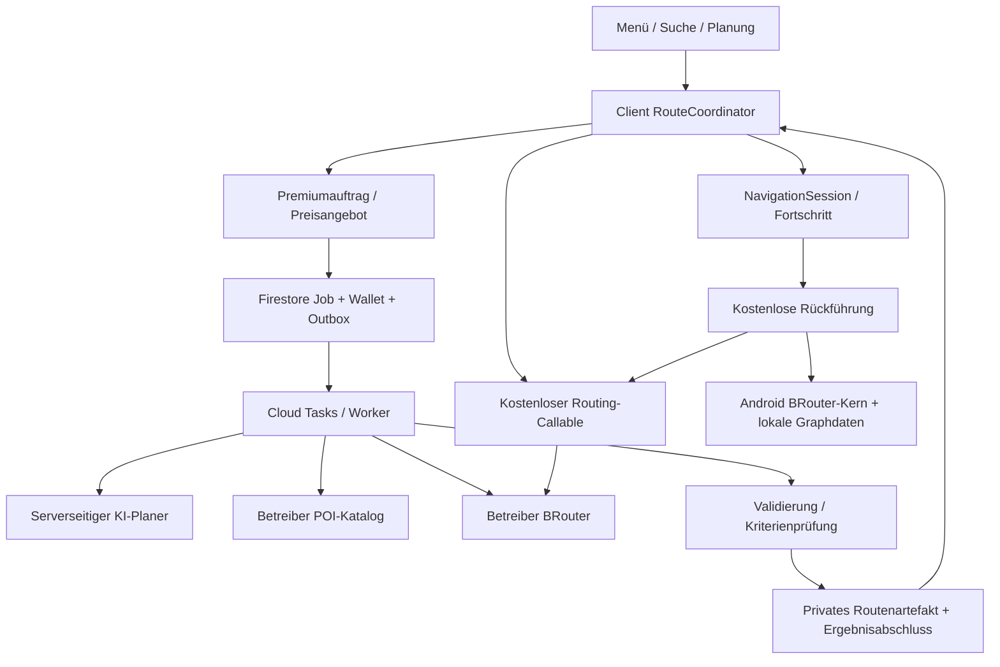

# Zielarchitektur v3: persönliche KI-Routen, kostenlose BRouter-Routen und Offline-Rückführung

Stand: 28.10.2026. Geprüfte Codebasis: Commit `8447969`. Status: **Architektur und Planungsentscheidungen, keine implementierten Funktionen oder Produktionsfreigabe.**

Der ausführbare Arbeitsablauf mit Abhängigkeiten und Abnahme steht in [ROUTING_IMPLEMENTATION_WORKPLAN.md](ROUTING_IMPLEMENTATION_WORKPLAN.md). Die Gamification bleibt in [GAMIFICATION_REALITY_AND_ROADMAP.md](GAMIFICATION_REALITY_AND_ROADMAP.md); gemeinsam benötigt wird zunächst nur die sichere Tokenbuchführung.

## Verbindliche Ergänzung vom 28.10.2026: Archiv vor Ergebnisfreigabe

Ausdrücklicher Benutzerauftrag: Keine erfolgreich erzeugte KI-Strecke darf durch neue Generierung, verworfene Vorschau oder Nichtfahren verloren gehen. Jede Generation und alle gültigen Alternativen erhalten eigene dauerhafte Archivbezüge. Ungefahrene Strecken, alle geplanten Strecken und tatsächliche Fahrtenhistorie bleiben getrennt zugänglich; Wiederholungsfahrten erzeugen zusätzliche Fahrteinträge. Keine automatische Bestandsbegrenzung oder 24-h-Löschung gültiger Ergebnisse. Ausdrückliche Löschung/Widerruf bleiben wirksam.

Client: Speicherung vor Vorschau, Speicherfehler sichtbar und erneute Generierung bis zur Sicherung gesperrt. Server-Premium: privates Artefakt plus dauerhafte Saved-Route-Metadaten vor bzw. atomar mit `ready`/Capture bereitstellen; nicht auf eine spätere Clientantwort oder einen manuellen Speichern-Klick warten. Diese Serveranbindung bleibt Teil des noch gesperrten Premiumbackends. Das implementierte lokale Gerätearchiv allein ist keine Cloud-/Mehrgeräte-Sicherung.

## 1. Ergebnis der Logikprüfung

[FAKT] Die folgenden Codepfade wurden gelesen. [SCHLUSS] Die Konsequenzen bestimmen die korrigierte Architektur. Liveanbieter und Geräte wurden bei dieser Dokumentarbeit nicht getestet.

| Befund und Evidenz | Fehler im bisherigen Ansatz | Festgelegte Korrektur |
| --- | --- | --- |
| `routingService.ts`: Zielplanung kennt nur `premium` und `offline`. | Kostenlose Online- und echte Offline-Planung werden vermischt. | Produktmodus und Rechenort getrennt modellieren. BRouter online kostet keine Token. |
| `aiAssistantService.ts`: KI schreibt überwiegend nach der Geometrieberechnung einen Text. | Eine Beschreibung macht eine Route noch nicht persönlich geplant. | KI muss Kriterien, echte Zwischenziele und Kandidatenauswahl beeinflussen; Ergebnis enthält belegbare Planungsmerkmale. |
| `vertexRouting.ts`: Modellergebnis wird verworfen, Antwort enthält Start/Ziel und feste Reichweitenrechnung. | Der vorhandene Callable ist kein Premium-Routenplaner. | Durch den neuen Auftragsdienst ablösen; alten Endpunkt anschließend schließen. |
| `App.tsx`, `handleAutoReroute`: ruft `generateAnticipatedRoute` auf. | Abweichung kann Ziel und Fahrtabsicht verlieren und eine neue Runde erzeugen. | Unveränderlichen Fahrtauftrag und Reststrecke erhalten; kostenlos zur bestehenden Route zurückführen. |
| `App.tsx`, `handlePlanRouteToStation`: ersetzt den letzten Punkt einer Rundroute. | Letzte Verbindung ist nicht durch das Wegenetz berechnet. | Ladestation als echtes Ziel oder bestätigtes Pflichtzwischenziel routen. |
| `useRouteTracker.ts`: nächster Geometriepunkt statt Segment, zwei Updates über 45 m, wiederholter Callback. | Dünne Geometrie, GPS-Rauschen und Schleifen erzeugen falsche Abweichungen und Request-Stürme. | Segmentprojektion mit Fahrtfortschritt, Genauigkeit, Zeit-Hysterese und einem aktiven Rückführungsauftrag. |
| Derselbe Hook erfindet Straßennamen wie „Uferpromenade“. | Linienwinkel belegen weder Kreuzung noch Straßennamen oder erlaubtes Abbiegen. | Manöver aus Routerdaten; fehlende Angaben ausdrücklich unbekannt. |
| `routingService.ts`: Kreis-/Luftlinienfallbacks; feste Oberflächen und Ladeversprechen. | Auch beschriftete Korridore dürfen nicht als Navigation startbar sein. | Fehler ohne neue Navigationsroute; Orientierungslinien höchstens eigener Anzeigetyp. |
| Höhen werden aus wenigen Stichproben aufsummiert und mit Punktzahlverhältnis multipliziert. | Geometrieverdichtung verändert Höhenmeter und Akkubewertung. | Höhenprofil nach Streckenabstand aufbereiten; keine Hochrechnung nach Punktzahl. |
| `useGeolocation.ts`: Startwert Berlin mit unbekannter Genauigkeit. | Kartenmittelpunkt könnte als echter Fahrtstart verwendet werden. | Standortquelle, Messzeit und Genauigkeit sind Pflicht; ansonsten Start manuell bestätigen. |
| `SearchInput.tsx`: öffentliche Nominatim-Suche nach 400 ms Tipppause. | Öffentliche Nominatim-Instanz untersagt Autocomplete; langsame alte Antworten können neue Suche überholen. | Betreibersuche, explizites Absenden, Abbruch und Antwortgeneration prüfen. Offline Ziel per Karte, Koordinate oder gespeichertem Ort. |
| `user_tokens` erlaubt dem Besitzer Löschen; mehrere Backendpfade verändern Guthaben. | Reservierungen allein im neuen Routenpfad würden durch Kontolöschung oder andere Ausgaben unterlaufen. | Kontolöschung nur im Gesamtworkflow; alle Guthabenschreiber auf ein gemeinsames Ledger umstellen. |
| `redeemVoucher` verwendet `unlimitedOnDemand`; Profildefault enthält `unlimitedDemandActive: true`. | Routenberechtigung könnte Gutscheine freistellen oder aus editierbaren Präferenzen abgeleitet werden. | Berechtigungen nach Produkt trennen; Gutscheine immer nach Gutscheinregeln bepreisen. |
| Ältere Gemini-IDs sind fest in Frontend und Backend eingetragen. | Ein gültiger API-Aufruf kann dennoch auf ein abgeschaltetes Modell zeigen. | Zentraler serverseitiger Modelladapter, aktuelle Freigabeprüfung für Modell/Region/SDK; kein stiller Anbieterwechsel. |

Die Nominatim-Aussage folgt der [offiziellen Nutzungsrichtlinie](https://operations.osmfoundation.org/policies/nominatim/). Googles [Modell-Lebenszyklus](https://docs.cloud.google.com/gemini-enterprise-agent-platform/models/model-versions) führt unter anderem Gemini 2.0 Flash als abgeschaltet. Das ist ein belegtes Integrationsrisiko, kein Nachweis der Ursache der früheren Testsuche.

## 2. Produktentscheidungen und Planungsdefaults

Die folgenden Werte sind bewusst gewählte Planungsdefaults. Sie werden versioniert implementiert; hier wird kein kostenpflichtiger Betrieb gestartet.

| Einstieg | Planung | Token und Voraussetzungen |
| --- | --- | --- |
| Einfache Routenplanung: „Kostenlos mit BRouter“ | Zielroute auf Radwegenetz; explizite Zwischenziele bleiben erhalten. | 0 Token; Onlineverbindung oder lokales Androidpaket. |
| Einfache Routenplanung: „KI-Premium-Generation“ | KI berücksichtigt aktuelle Fahrtangaben und bewusst freigegebene Präferenzen. | Default 1 Token pro erfolgreich bereitgestelltem Ergebnis; angemeldetes Konto. |
| „KI heute Strecke“ als erster Menüpunkt | Persönliche Rundtour; Distanz und Thema auswählbar, gespeicherte Präferenzen sichtbar. | Derselbe Premiumauftrag und Preis; keine automatische Berechnung beim Appstart. |
| Erweiterte Routenplanung (Premium) | Wünsche, geordnete Pflichtstopps, optionale Interessen, zusätzliche freigegebene Präferenzen. | Aktives serverbestätigtes Premiumabo; gleicher Tokenpreis, außer ausdrücklich bestätigtem Routen-Flatrateanspruch. |
| Abweichung während einer Fahrt | Verbindung zur verbleibenden Originalroute; danach ursprüngliche Route weiterfahren. | Immer 0 Token und ohne neue KI-Anfrage. Offline lokal, online BRouter. |
| Bewusst „Tour neu entwerfen“ | Neuer persönlicher Auftrag mit neuen Zielen oder Prioritäten. | Neuer bestätigter Premiumauftrag; niemals automatisch durch GPS ausgelöst. |

„Offline-Generation“ wird nur bei verfügbarer lokaler Engine und passenden Daten als Berechnung angeboten. Web/iOS zeigen bis zu einer eigenen nachgewiesenen Engine „Offline-Routing nicht verfügbar“. Die kostenlose Onlineoption bleibt unabhängig davon verfügbar.

V1: E-Bikes mit Fahrradprofil, keine S-Pedelec-/Kfz-Routen. Onlinepilot Berlin/Brandenburg mit sichtbar ausgewiesener Datenabdeckung; Architektur verarbeitet später weitere Regionen über dieselben Manifest- und Adapterverträge. Android erhält echte lokale Berechnung zuerst. Web/iOS unterstützen Onlineplanung und das Anzeigen gespeicherter Routen. Hintergrundnavigation bei ausgeschaltetem Display gehört zur Android-Abnahme.

## 3. Komponenten und Vertrauensgrenzen

- Gemeinsames TypeScript-Modul für Requests, Resultate, Einheiten, geometrische Prüfungen und stabile Fehlercodes. Backend besitzt Berechtigung, Preis und finalen Premiumprüfstatus; lokale Free-Ergebnisse erhalten keine nachträgliche Premiumbestätigung.
- React-Komponenten bedienen einen `RouteCoordinator`. Dieser hält Entwurf, Anfragegeneration, Auth-/Consentgeneration und aktive Navigation getrennt. Eine neue Vorschau ersetzt eine laufende Fahrt erst nach bewusster Übernahme.
- Onlinegraph: eigener BRouter-Dienst mit gepinnter Engine, erlaubten Profilen und versionierten `.rd5`-Daten. Betriebsvorgabe: regionaler Container auf Compute Engine mit persistentem Datenträger in `europe-west3`, privater Zugriff vom Backend über VPC. Keine öffentliche Profilausführung oder frei wählbaren Upstream-URLs.
- Geocoding: eigene regionale Nominatim-Instanz mit PostgreSQL/PostGIS, Zugriff über Betreiberbackend. V1 sucht nach Enter/Suchen statt nach jeder Tipppause; Ergebnisauswahl liefert stabile Ortsreferenz und Koordinate. POIs stammen aus einem räumlich indizierten, versionierten regionalen OSM-Import plus den vorhandenen Communitydaten mit gesondertem Vertrauensstatus. Keine öffentlichen Bulk-/Overpass-Abfragen je KI-Auftrag.
- Premium: Firebase Callables und Task-Worker im vorhandenen Projekt. Modellzugriff nur serverseitig über Google Gen AI SDK; vorhandene allgemeine Chat-/Sprachfunktionen berechtigen nicht zur Premiumroutenfreigabe. Der alte `computeRoute` darf keinen alternativen Bezahlweg offenhalten.
- Android: eigener Capacitor-Adapter um gepinnten Java-BRouter-Kern, lokaler Hintergrundthread und kontrollierte Abbruch-/Speichergrenzen. Keine vorausgesetzte Installation einer fremden BRouter-App. Native Integration wird früh durch einen Prototyp abgesichert.
- Kartenrendering, Straßengraph, Ortssuche und Sprachansagen sind getrennte Fähigkeiten. Kartentiles sind kein Routinggraph; Cache Storage ist kein nachgewiesenes Offlinekartenpaket. Für die Offlinefahrt enthält das Paket zusätzlich lizenziert nutzbare Basiskartendaten oder die UI weist ausdrücklich auf fehlenden Kartenhintergrund hin.

Diese Betriebswahl ist ein Entwurf. Server, Modellfreigabe, native Bridge und Datenimporte sind damit nicht als vorhanden behauptet.

## 4. Verträge, Einheiten und Datenqualität

`RouteRequestV1` enthält `requestId`, `kind: destination|roundtrip`, `planning: standard|ai`, Start, Ziel oder Rundtourdaten, geordnete Pflichtstopps, optionale Interessen, harte Anforderungen, gewichtete Wünsche und einen expliziten Profil-Snapshot. Rechenort `online|local` ist ein Ausführungsattribut, kein Preismerkmal.

- Interne Positionen sind benannte `{lat,lng}`-Objekte. GeoJSON und BRouter verwenden adapterseitig `[lng,lat]`. Alte `[lat,lng]`-Arrays werden ausschließlich am Übergang zum bisherigen Renderer erzeugt. Meter, Sekunden und Wattstunden sind kanonisch; Umrechnung erst in der UI.
- Standort enthält `source: gps|manual|saved`, `observedAt`, `accuracyM` oder eine dokumentierte manuelle Bestätigung. Ein Kartenmittelpunkt ist keine GPS-Messung. Vor Routebeginn ist ein brauchbarer Start nötig; manueller Start erlaubt Vorschau, Navigationsfortschritt erfordert aktuelle Messungen.
- Harte Anforderungen sind insbesondere Zielbindung, Reihenfolge der Pflichtstopps, Fahrradprofil und ausdrücklich gesetzte Verbote. Thema, schöner Weg, bevorzugter Untergrund und flachere Strecke sind standardmäßig weiche Wünsche. Unbekannte Daten erfüllen keine harte Bedingung. Widersprüche werden vor der Reservierung angezeigt; keine stillen Lockerungen.
- Eingabepriorität: bestätigte Fahrtangaben vor aktiv ausgewählten Profilwerten vor optional freigegebenen Mustern. Herkunft und Alter bleiben sichtbar. Keine Nutzung vollständiger GPS-Historie, fremder Konten oder alter Zustimmungssitzungen. Akku 0 Prozent bleibt 0; unbekannter Akku bleibt unbekannt.
- V1-Grenzen: maximal 5 Pflichtstopps, 2.000 Zeichen Wünsche, 200 km berechnete Gesamtstrecke; Rundtour-Ziellänge 5–120 km. Ungeeignete/außerhalb liegende Ziele liefern einen konkreten Fehler. Keine Aufteilung in verdeckte zusätzliche Bezahlaufträge.

`RouteCandidateV1` enthält Geometrie, segmentierte Distanz/Höhen, Manöver, erreichte Pflichtstopps, POI-Referenzen, Engine-/Daten-/Profilversion, Kriterienbefunde und Qualitätsangaben. `ValidatedRouteV1` ergänzt Requestbezug, Prüfversion, Inhaltshash und für Premium den serverseitigen Ergebnisbeleg. Der Routentyp trägt zusätzlich `guidanceCapability: track|turn_by_turn`. Geführte Navigation erfordert geprüfte Manöver und `turn_by_turn`; eine reine geprüfte Linie bleibt Trackanzeige. Eine Orientierungslinie ist kein `ValidatedRouteV1`.

`NavigationSessionV1` hält lokal Originalroute, aktive Rückführungsverbindung, Reststrecke, erreichte Pflichtstopps, Fortschritt entlang der Originalroute und letzte brauchbare Position. Der Originalauftrag wird nicht durch die Rückführungsgeometrie überschrieben.

`RouteMetrics` trennt Wert, Quelle und Qualität (`known|estimated|unknown`). Fehlende Höhen/Oberflächen werden nicht als 0 oder feste Prozente ausgegeben. Energie ist eine Schätzung mit konservativer Reserve, keine sichere Reichweitenzusage. Ohne notwendige Fahrrad-/Akkudaten oder Höhen ist der Batteriestatus `unknown`, nicht `safe`. Messpunktdichte darf Distanz-/Höhen-/Energieergebnis nicht wesentlich verändern.

## 5. Wie die KI die Route tatsächlich plant

1. Backend validiert Anfrage, Zustimmungsversion, Kontostatus und Fähigkeiten der Datenquelle. Bei unklaren harten Anforderungen verlangt es eine präzisierte Eingabe. Preisangebot bindet Requesthash, Preisversion, Berechtigung und Daten-/Plannerstand; gültig 5 Minuten.
2. Nutzer bestätigt Preis und Datennutzung. Eine Transaktion erzeugt den Auftrag und reserviert den Betrag. Ein erneuter Klick mit demselben Schlüssel liefert denselben Auftrag.
3. Worker liest den bestätigten Snapshot und maximal 40 räumlich passende, reale POIs. Freitext und POI-Texte sind Daten, keine Anweisungen zur Ausführung. Kein freies Browsen, keine KI-generierten Profile, Shellbefehle, URLs oder unbestätigten Ortskoordinaten.
4. KI-Aufruf 1 liefert ein schemageprüftes Planungsobjekt: Kriteriengewichtung, erlaubtes Profil aus Registry, Auswahl realer Orts-IDs und höchstens 3 unterschiedliche Kandidatenpläne. Rundtouren brauchen mindestens zwei netzverbundene Anker oder eine nachgewiesene native Rundtourfunktion; kein geometrischer Kreis als Route.
5. BRouter berechnet bis zu 3 Kandidaten mit den tatsächlich unterstützten Profilparametern. Optionales Profilwissen wird gegen eine Fähigkeitsmatrix geprüft. Eine Präferenz ohne passenden Parameter kann über belegbare Kandidatenmerkmale bewertet werden; sie darf nicht als garantiert erfüllt erscheinen.
6. Deterministische Validierung entfernt ungeeignete Kandidaten. KI-Aufruf 2 bewertet ausschließlich vorhandene Kandidaten-IDs anhand der gelieferten Fakten und formuliert kurze nachvollziehbare Gründe. Harte Prüfungen haben Vorrang vor KI-Rang und Text. Bei identischen Geometrien werden Kandidaten dedupliziert.
7. Ergebnis muss zeigen, welche Eingaben Profil, Zwischenziele oder Auswahl beeinflusst haben. Gleiche Geometrie wie eine kostenlose Route kann sachlich richtig sein; ein bloß angehängter Text ohne vorherige persönliche Planung zählt nicht als Premiumerfolg. Fehlendes gültiges KI-Planungs-/Auswahlergebnis führt zur Freigabe der Reservierung.
8. Ein gültiges Ergebnis mit ausgewählter Route und gegebenenfalls Alternativen wird privat gespeichert und atomar freigegeben/abgerechnet. Alternativen aus demselben Auftrag kosten zusammen einmal. Weitere ausdrückliche Neuentwürfe sind neue Aufträge.

Grenzen: 2 fachliche KI-Phasen mit je insgesamt 20 s Zeitbudget, maximal 2 physischen Requestversuchen je Phase und maximal 4 je Job. Jeder Versuch erlaubt höchstens 8.000 Eingabe- und 4.096 Ausgabetokens. Versuchszähler werden vor dem Provideraufruf persistent atomar erhöht; automatische versteckte SDK-Retries ausschalten. Erfolgreiche Phasenergebnisse werden persistiert und beim Workerretry wiederverwendet. Bei unklarem Aufrufausgang nur innerhalb der verbliebenen Versuchs-/Kosten-/Zeitgrenzen erneut anfragen, andernfalls Job fehlschlagen lassen. Graphanfrage maximal 10 s, 2 gleichzeitig; gesamter Worker maximal 90 s und Jobdeadline 180 s ab Annahme. Kein Retry erzeugt zusätzliche Kandidaten oder unbeschränkte KI-Schleifen. Grenzwerte sind Startvorgaben, keine gemessenen Laufzeiten.

Modellvorgabe für den Prototyp: serverseitig konfiguriertes stabiles `gemini-3.5-flash`, keine Legacy- oder Preview-ID. Vor Nutzung werden aktuelle Verfügbarkeit, unterstütztes strukturiertes Ausgabeformat, Projektzugriff, Kosten und zulässige Region in einem minimalen Probeaufruf geprüft. Ist die festgelegte regionale Ausführung nicht möglich, bleibt Premium geschlossen; es gibt keinen automatischen Wechsel in eine andere Region. Der konkrete SDK-Aufruf wird aus den dann gepinnten Typdefinitionen/Dokumenten übernommen, nicht aus alten Codebeispielen. [Google SDK-Migration](https://ai.google.dev/gemini-api/docs/migrate?authuser=0), [strukturierte Ausgabe](https://docs.cloud.google.com/gemini-enterprise-agent-platform/models/capabilities/control-generated-output?hl=en).

## 6. Validierung und Navigation

Die eigene Prüfung bestätigt Struktur, Plausibilität und Vertragsbedingungen. Sie beweist nicht unabhängig jede befahrbare Graphkante. Engineherkunft, Profil und Kartenstand bilden die Grundlage; aktuelle Sperrungen und tatsächliche Zugänglichkeit können abweichen.

- Schema, endliche Koordinaten/Wertebereiche, mindestens zwei sinnvolle Punkte, keine unerlaubten direkten Teilstücke, Grenzen für Punktzahl (100.000) und entpackte Artefaktgröße (8 MiB). Unvollständige Antworten werden verworfen, nicht durch direkte Linien ergänzt.
- Start-/Ziel-/Via-Bindung innerhalb erlaubter Snapdistanz: Default 50 m; größere Verschiebung braucht eine Nutzerentscheidung vor Übernahme. Abstand zum gesnappten Straßenpunkt wird separat angezeigt und nicht durch ein erfundenes befahrbares Anschlussstück geschlossen. Pflichtstopps werden geometrisch entlang der Strecke und in Reihenfolge nachgewiesen. Ein POI in der Nähe zählt nicht als besuchter Pflichtstopp.
- Länge aus Geometrie und Routerlänge gegeneinander prüfen, Abweichung über 5 Prozent untersuchen/ablehnen. Rundtouren müssen Start/Ziel verbinden und die Wunschdistanz standardmäßig innerhalb ±20 Prozent treffen. Kein passender Kandidat: Anforderung ändern lassen, keine falsche Erfolgsmeldung.
- Höhen aus Router/Graph bevorzugen, konsistent nach Streckenabstand resamplen und gegen Ausreißer glätten. Maximalsteigung nur bei hinreichend belastbarem Höhen-/Segmentprofil als geprüft ausweisen. Fehlende Zusatzdaten dürfen kostenlose Geometrieplanung nicht unnötig blockieren, wohl aber eine darauf angewiesene harte Premiumbedingung.
- Oberflächenanteile und Ladepunkte nur aus vorhandenen Quelldaten. OSM-/Communityeintrag beweist keine aktuelle freie Steckdose oder Öffnung. Akkuplan mit erforderlichem Ladestopp braucht kompatiblen und hinreichend dokumentierten Stopp oder meldet die Einschränkung.
- Manöver kommen aus der gepinnten Routerantwort und werden auf Geometrieindizes/Distanz bezogen. Keine erfundenen Straßennamen. Fehlen Manöver, ist nur Trackanzeige verfügbar; eine entsprechende Route wird nicht als vollständig geführte Premiumroute verkauft. LLM darf Ansagen verständlicher formulieren, aber Abbiegung, Entfernung und Fahrtrichtung nicht verändern.
- Alte GPX-/gespeicherte Routen bleiben lesbar, erhalten `legacy_unverified` und werden nicht allein durch Typumwandlung validiert. Nutzer kann sie als Track ansehen; eine aktuelle Neuplanung ist ein eigener ausdrücklicher Vorgang.

## 7. Wallet, Aufträge und Abbruchrennen

### 7.1 Ein gemeinsames Guthabenmodell

`user_tokens/{uid}` bekommt `schemaVersion`, `balance` (sofort ausgebbar) und `reservedBalance` (gebunden). Ausschließlich ganzzahlige, nichtnegative Token. Bestehender `lifetimeEarned` bleibt ein kumulativer Earn-Zähler, keine Budgetquelle. Jede Transaktion schreibt einen deterministisch benannten Ledgerbeleg mit Anlass, Referenz und Änderungen beider Salden.

| Vorgang | Änderung balance | Änderung reservedBalance |
| --- | ---: | ---: |
| Verdienen | +Betrag | 0 |
| Reservieren | −Preis | +Preis |
| Erfolgreichen Auftrag abrechnen | 0 | −Preis |
| Abbrechen/Fehler vor Ergebnis | +Preis | −Preis |
| Gutschein kaufen | −Gutscheinpreis | 0 |

Damit können Gutscheine keine für Routen reservierten Token verbrauchen. Quiz, Rad, Gutscheine, spätere Käufe und Supportkorrekturen verwenden dieselben atomaren Hilfsfunktionen. Keine externen KI-/Routeraufrufe innerhalb einer Firestore-Transaktion: Firestore kann Transaktionsfunktionen wiederholen. [Offizielle Transaktionsregeln](https://firebase.google.com/docs/firestore/manage-data/transactions).

Premium-Grundplanung ist mit Token nutzbar. Erweiterte Planung verlangt `subscriptions/{uid}` mit aktivem, nicht abgelaufenem Anspruch. Ein expliziter, serverbestätigter `routesUnlimited`-Anspruch setzt nur den Routenpreis auf 0 und bleibt ratenbegrenzt. Editierbare Profilfelder und das alte generische Unlimited-Flag autorisieren nichts. Gutscheine bekommen keine Routen-Flatrate. Preis und gewöhnlicher Aboablauf sind bei Annahme für die maximal 180 s Auftragslaufzeit fixiert; ein Konto-/Betrugssperrstatus oder expliziter Widerruf vor Abschluss beendet den Auftrag mit Release. Ein zwischenzeitlich normal ablaufendes Abo löst keine nachträgliche Nachforderung aus.

### 7.2 Persistenter Zustandsautomat

`queued → running → ready` oder `queued|running → cancelled|failed|expired`. Terminalzustände sind unveränderlich; ein serverbestätigter Artefaktschaden kann über einen separaten Erstattungsbeleg korrigiert werden. `ready` bedeutet: Artefakt vorhanden, servergeprüft und für dieses Konto abrufbar; erst dann ist die Reservierung verbraucht.

- Preisangebot und UUID-Schlüssel werden vor dem ersten Absenden lokal gesichert. Der Server bindet den Schlüssel an UID und normalisierten Requesthash. Derselbe Schlüssel mit anderen Daten liefert `IDEMPOTENCY_CONFLICT`; derselbe Request mit neuem Schlüssel ist bewusst ein neuer Kauf.
- Annahme reserviert Token und schreibt eine Outbox atomar. Dispatcher stellt Cloud Task ein; Wiederholung/Absturz zwischen beiden Schritten darf weder Auftrag verlieren noch doppelt abbuchen. Scheduler repariert nicht zugestellte Outboxeinträge.
- Worker erhält eine erneuerbare Lease und Generation. Nur der aktuelle Eigentümer darf abschließen. Zustands-/Wallettransaktionen vergleichen Jobstatus, Generation, Deadline und Kontosperre. Fremde/veraltete Worker dürfen keine Ergebnisse freigeben.
- Artefakt wird zunächst privat unter einer versuchsbezogenen unveränderlichen Objekt-ID gespeichert. Abschluss verknüpft genau dessen geprüften Hash und rechnet atomar ab. Verwaiste Objekte werden später gelöscht. Großgeometrien gehören in privaten Object Storage; Firestore hält Metadaten, keine unbegrenzten Punktarrays. Firestore begrenzt Dokumente auf [1 MiB](https://firebase.google.com/docs/firestore/quotas).
- Gewinnt ein bestätigtes Cancel vor dem Abschluss, werden Token einmal freigegeben und das Ergebnis bleibt unzugänglich. Gewinnt `ready`, liefert Cancel `ALREADY_READY`; kein Refund durch Wegklicken einer bereits verfügbaren Route. Die UI nennt diese Regel vor dem Start.
- Verlorene HTTP-Antwort, Appneustart oder fehlender Download lösen keine zweite Buchung aus: Auftragstatus abrufen und vorhandenes Ergebnis erneut laden. Ein Serverartefaktschaden führt nach serverseitigem Nachweis genau einmal zur Erstattung; eine reine Clientfehlermeldung reicht nicht.
- Ein bestätigter Abbruch ist nur nach Serverantwort bestätigt. Offline-Cancel wird lokal vorgemerkt und bei Netzwiederkehr gesendet; die UI erklärt bis dahin den unbekannten Serverstand. Consentwiderruf stoppt lokale Arbeit und veranlasst soweit erreichbar Servercancel; bereits bereitgestellte Ergebnisse bleiben vom Abbruchrennen abhängig.
- Jobdeadline 180 s; Scheduler jede Minute setzt fällige Aufträge terminal und löst Reservierungen. Zusätzliche Reserveablaufgrenze 15 Minuten schützt vor verwaisten Jobs. Diese Wiederherstellung ist Anwendungslogik, keine TTL-Hoffnung: [Firestore TTL löscht nicht sofort und nicht transaktional](https://firebase.google.com/docs/firestore/ttl).
- Keine Zusage „externer KI-Aufruf exakt einmal“: Taskzustellung und Providerantwort können wiederholt/unklar sein. Persistente Schritte, begrenzte Versuche und Kostenbudgets beschränken den Schaden; Nutzerabrechnung bleibt genau einmal.

### 7.3 Endpunkte und Zugriff

- `getRoutingCapabilities`: Abdeckung, Modi, Profile, aktive Preis-/Consentversion und Funktionsstatus; keine privaten Standorte.
- `searchPlaces`: abgesendeter Suchtext und optional gewählte Region; maximal 5 Ergebnisse; 10 s Timeout, Abbruch/Generation am Client.
- `computeFreeRoute`: validierter Standardauftrag, Ergebnis oder stabiler Fehler; 0 Token, App Check, Konto optional, serverseitige Abusebegrenzung.
- `quotePremiumRoute`: Requesthash, Angebot-ID, Preis, Ablauf und erfasste Datenauswahl. Keine KI-Erzeugung und keine Reservierung.
- `createPremiumRoute`: Angebot-ID, unveränderte Anfrage und Idempotenzschlüssel; gibt Job-ID zurück.
- `getPremiumRouteJob`, `getPremiumRouteResult`, `cancelPremiumRoute`: UID-Prüfung bei jedem Zugriff; Ergebnisdownload über authentifizierten Zugriff, keine dauerhaften öffentlichen Downloadtokens.
- `savePremiumRouteResult`: idempotenter Archiv-/Abrufpfad für bereits automatisch dauerhaft gespeicherte eigene Ergebnisse. Jedes erfolgreiche Ergebnis einschließlich gültiger Alternativen erhält vor `ready` private Artefakte und Saved-Route-Metadaten bis zur ausdrücklichen Löschung. Kein manueller Speicherklick als Voraussetzung, kein 24-h-Verfall gültiger Strecken; zusätzlich lokale Kopie für die Fahrt.
- Native Bridge: `capabilities`, `listPackages`, `downloadPackage`, `removePackage`, `computeRoute`, `cancel`. Pfade und Profile sind allowlisted; weder Modell noch Webview geben beliebige Dateipfade/Code vor.

Stabile Fehlercodes umfassen `INVALID_START`, `CONSENT_REQUIRED`, `UNSUPPORTED_CONSTRAINT`, `NO_RESULTS`, `NO_ROUTE`, `OUTSIDE_COVERAGE`, `ROUTE_INVALID`, `MANEUVERS_UNAVAILABLE`, `MODEL_UNAVAILABLE`, `PREMIUM_REQUIRED`, `INSUFFICIENT_TOKENS`, `IDEMPOTENCY_CONFLICT`, `RATE_LIMITED`, `OFFLINE_GRAPH_MISSING`, `CANCELLED`, `EXPIRED`. Kein Fehler erzeugt eine startbare Luftlinie.

## 8. Abweichung und kostenlose Rückführung

### 8.1 Erkennung

Position wird auf Segmente im plausiblen Fenster entlang des Fahrtfortschritts projiziert, nicht auf den weltweit nächsten Punkt der Route. Ein räumlicher Index verhindert Vollscans pro GPS-Tick. Rundtourstart/-ende und Selbstkreuzungen werden über Streckendistanz, Richtung und erreichte Pflichtstopps getrennt.

Startwerte zur späteren Trackabnahme: Messung höchstens 10 s alt, Genauigkeit höchstens 30 m; Abweichungsgrenze `max(35 m, 2 × accuracyM)` mindestens 8 s lang und mit mindestens 3 brauchbaren Messungen. Schlechte Positionsqualität setzt `position_uncertain`. Rückkehr gilt unter 20 m für 5 s und mindestens 2 brauchbare Messungen. Ein GPS-Sprung allein löst weder Rückführung noch Zielerreichung aus.

Eine Rückführung gleichzeitig, danach 20 s Sperrzeit. Während der Verbindung wird nur neu gerechnet, wenn der Fahrer auch sie belastbar verlässt oder sie unbrauchbar wird. 0 Token, keine wiederholten KI-Anfragen.

### 8.2 Auswahl des Wiedereintritts

1. Originalroute, Fortschritt und nächste unerledigte Pflichtstopps behalten. Bis zu 5 Kandidaten aus dem vorausliegenden Restabschnitt (zunächst bis 5 km voraus) auswählen; nicht über den nächsten Pflichtstopp springen. Falls innerhalb dieses Bereichs kein Kandidat erreichbar ist, Fehler anzeigen statt ungefragt weiter entfernte Stopps zu überspringen.
2. Mit tatsächlichem Fahrradrouter eine Verbindung zu Kandidaten berechnen. Luftliniennähe reicht bei Fluss, Bahn, Brücke oder Einbahnführung nicht. Harte Bedingungen und Pflichtstopps zuerst filtern. Danach verbindliche Auswahl nach kleinstem Routerkostenwert der Verbindung, bei Gleichstand kürzere Verbindungsdistanz, danach frühester erlaubter Eintritt entlang der Originalroute. Profilpräferenzen sind im Routerkostenwert enthalten; keine undokumentierte zusätzliche KI-Rangfolge. Vor Übernahme grobe Richtungswechsel und größeren Umweg ankündigen.
3. Verbindung und Originalrest am belegten Segmentpunkt zusammenführen; Geometrie, Manöver, Restmetriken und Via-Reihenfolge erneut prüfen. Keine direkte Lücke zwischen beiden Linien. Rückführung bleibt ein eigener Abschnitt der Session.
4. Validierte Verbindung automatisch übernehmen und ruhig ankündigen: „Zur geplanten Strecke zurückführen“. Kein Bestätigungszwang während jeder normalen Abweichung. Nutzer kann pausieren/abbrechen. Eine neue Tour oder übersprungene Pflichtstopps brauchen dagegen bewusste Entscheidung.
5. Bei Wiedereintritt Verbindung beenden und Originalfortschritt weiterführen. Bei erneuter Abweichung gleicher Ablauf mit Sperrzeit. Keine Endlosschleife aus Neuberechnungen pro Positionsupdate.

### 8.3 Online/Offline und Grenzen

Bei gültigem lokalen Androidpaket Rückführung bevorzugt lokal berechnen, auch wenn Netz vorhanden ist. Sonst online kostenlos BRouter verwenden, sofern aktuelle Übermittlungszustimmung besteht. Netzstatus ist ein Hinweis; erst tatsächliche Timeouts/Antworten bestimmen Verfügbarkeit.

Ohne Graph, Abdeckung oder erreichbaren Wiedereintritt bleibt die letzte Route sichtbar, geführte Abbiegeansagen zur unbekannten Verbindung pausieren. Nutzer sieht Position und Einschränkung. Es wird keine sichere neue Verbindung zum letzten Trackpunkt behauptet. Gespeicherte eigene Spur kann als Orientierung gezeigt werden, ist aber keine neu geprüfte Rückroute. Netzwiederkehr löst nur eine noch nötige kostenlose Rückführung aus, keinen KI-Kauf und keinen neuen Tourentwurf.

## 9. Offlinepakete und Androidbetrieb

V1 verwendet BRouter-Datenpakete mit versioniertem Engine-/Profil-/Lookup-Verbund. Die upstream dokumentierten `.rd5`-Segmente sind geografisch grob geschnitten; ein schmaler Routenkorridor bedeutet nicht automatisch einen kleinen Download. Größen werden vor dem Download aus dem Manifest angezeigt. Kein Versprechen fester geringer Paketgröße. [BRouter-Projekt und Datenmodell](https://github.com/abrensch/brouter).

- Signiertes Betreibermanifest nennt IDs, Abdeckung, SHA-256, Bytegröße, Datenalter, unterstützte Profile und Kompatibilitätsversion. Paketdownload erst nach Auswahl; Unterbrechungen fortsetzen, temporär schreiben, vollständig prüfen und atomar aktivieren. Alte funktionierende Version bis zum erfolgreichen Wechsel behalten.
- Start/Ziel innerhalb einer Boundingbox beweisen nicht, dass alle nötigen Graphteile vorhanden sind. Der Router muss fehlende Segmente melden; unvollständige oder gemischte inkompatible Versionen bleiben deaktiviert. Paketgrenzen und benachbarte Segmente sind Pflichtfälle im Prototyp.
- Genügend Speicher für alte und neue Version plus Reserve prüfen. Kein unbegrenztes Cachewachstum. Aktive Navigation hält eine Paketversion fest; Löschen/Update während einer Berechnung wird sicher serialisiert oder nach Fahrtende ausgeführt.
- Private Navigation separat von wiederverwendbaren öffentlichen Kartendaten speichern. Android appprivat; sensible Sessiondaten mit Schlüssel aus Android Keystore, Web als löschbare IndexedDB-Sitzung ohne unbelegte Verschlüsselungszusage. Nutzer kann Fortsetzungsspeicherung ausschalten.
- Androidnavigation startet ausdrücklich im Vordergrund, erhält einen Location-Foreground-Service mit sichtbarer Benachrichtigung für die aktive Fahrt und beendet Ortung bei Fahrtende, Widerruf oder Berechtigungsentzug. Keine Zusage, dass ein Webview-Timer bei ausgeschaltetem Bildschirm genügt.
- Offlinepaket umfasst die für Darstellung/Anweisungen nötigen Daten; neue freie Adresssuche offline ist in V1 nicht enthalten. Kartenwahl, gespeicherte Ziele und Koordinaten bleiben verfügbar.
- Beim Consentwiderruf zuerst Ortung und Schreib-/Berechnungsarbeit stoppen, danach private Sessions, routenbezogene Caches und heruntergeladene Offlinepakete löschen. Den Abschluss der Löschung abwarten und Teilfehler melden; keine pauschale Erfolgsmeldung vor Ende der nativen Bereinigung.
- Native Routenberechnung läuft abseits des UI-Threads mit Timeout/Cancel. Die gemeinsame Validierung prüft auch ihr Ergebnis. Web/iOS können lokale BRouter-Javaklassen nicht unverändert verwenden; dafür wird keine Offlineunterstützung vorgetäuscht.

## 10. Betrieb, Migration und Freigabe

- Pilotbegrenzung: maximal 1 aktiver Premiumauftrag pro UID, 10 Erzeugungen pro Stunde/UID, 50 pro Tag/UID, maximal 2 gleichzeitig laufende Premiumworker global. Free-Suche/-Routing je 15 Requests pro Minute je UID oder kurzlebigem serverseitigem IP-Hash; Limits sind keine Sicherheitseigenschaft eines clientgewählten Installationsnamens. Proxy-/App-Check-Konfiguration muss auf echten Web-/Android-/iOS-Origins geprüft werden.
- Pilotkostenlimit als serverseitige Vorgabe: 20 USD geschätztes Providerbudget pro Tag und maximal 1 USD gebundene Providerkosten pro Job, zusätzlich zur Nutzertokenreservierung. Modellpreise vor Freigabe aktuell hinterlegen, vor jedem physischen Aufruf das konservative Maximum inklusive möglicher Wiederholungen atomar reservieren und tatsächlichen Verbrauch abgleichen. Ein Aufruf mit unbekanntem Ausgang bleibt bis zur Klärung mit seinem Maximum belastet, damit ein Timeout das Budget nicht künstlich freigibt. Unbekannte/überschrittene Kosten schließen neue Premiumjobs; kostenlose Navigation bleibt verfügbar. Diese Werte sind Planungsdefaults, keine Ausgabengenehmigung oder gemessene Kosten.
- Rohstandorte, Freitextwünsche und private Routen nicht standardmäßig protokollieren. Metriken: Fehlercode, Dauer, Validierungsquote, Auftragszustand, einmalige Buchung, fällige Reservierungen, Providerverbrauch und Rückführungsrate. Kein globaler Cache privater Premiumpläne nach Koordinate.
- Jobrohdaten und ausschließlich verwaiste/fehlgeschlagene temporäre Artefakte nach 24 h löschen; dauerhaft archivierte gültige Strecken und Fahrten davon ausnehmen; Status ohne Geometrie/Wünsche und Idempotenzbeleg 30 Tage. Reservierungen vorher aktiv abschließen. Persistierte Kaufangebote enthalten serverseitige Ausgabe-/Ablaufzeit, sodass alte Wiederholungen nach Ablauf der Idempotenzaufbewahrung nicht neu gekauft werden. Geld-/Tokenbelege werden datensparsam 90 Tage für den Pilot gehalten; längere Aufbewahrung bedarf einer begründeten Produkt-/Rechtsentscheidung.
- Kontolöschung markiert Konto zuerst für neue Arbeit gesperrt, stoppt Jobs, löst Reservierungen und entfernt private Artefakte/Profile/Sessionbezüge; Retry darf nichts wiederherstellen. Die 90-Tage-Pilotaufbewahrung verlängert keine UID-Verknüpfung gegen den Löschauftrag: verbliebene betriebliche Belege werden nach dem notwendigen Abschluss ohne rückführbare Kontoreferenz anonymisiert oder gelöscht. Teilfehler bleiben retryfähig; Abschluss erst nach erfolgreicher Pflichtbereinigung melden. Erforderliche Lösch-/Ledgerregeln sind gemeinsam mit dem bestehenden Löschworkflow zu prüfen. Keine pauschale rechtliche Konformitätsbehauptung.
- Migration führt je Konto einmal einen Eröffnungsbeleg ein, erhält vorhandenes Guthaben und setzt Reservierungen auf 0. Bereits laufende Altschreiber werden über eine kurze Schreibpause/Featureflags kontrolliert. Firestore-Regeln untersagen danach auch direktes Kontolöschen. Geometrien alter Routen werden nicht still als neu validiert markiert.
- Getrennte Schalter für Free, Premium, Android-Offline und Rückführung. Kill-Switch verhindert neue Jobs und löst bestehende Reservierungen kontrolliert; er beendet nicht blind eine laufende gültige Fahrt. Rollback lässt Ledger/Resultatleser kompatibel und darf keinen alten manipulierbaren Guthabenschreiber aktivieren.
- Freigabe erst nach den Gates im Arbeitsplan. Native Machbarkeit, aktuelle Modell-/Regionverfügbarkeit, Infrastrukturkosten und reale Provider-/Geräteantworten sind [NICHT GEPRÜFT]. Schlägt ein Gate fehl, bleibt die betroffene Fähigkeit deaktiviert; keine Ersatzimplementierung durch Luftlinie oder KI-Geschichte.

## 11. Externe Evidenz und Geltungsgrenzen

Quellen am 27.10.2026 gelesen; sie belegen Fähigkeiten/Regeln der Upstreamsysteme, nicht die Verfügbarkeit im Projektkonto.

- [BRouter Android-Service](https://github.com/abrensch/brouter/blob/master/docs/developers/android_service.md): native Schnittstelle, Via- und Profilparameter. Eingebetteter Capacitor-Adapter ist eigene geplante Arbeit.
- [BRouter RoutingEngine](https://raw.githubusercontent.com/abrensch/brouter/master/brouter-core/src/main/java/btools/router/RoutingEngine.java): Java-Kern; Kompatibilität mit dem Ziel-Androidbuild separat nachweisen.
- [BRouter ServerHandler](https://raw.githubusercontent.com/abrensch/brouter/master/brouter-server/src/main/java/btools/server/request/ServerHandler.java): Routerparameter und Manövermodus; konkrete Antwortfelder gegen die gepinnte Version testen.
- [OSRM-Profile](https://project-osrm.org/docs/v6.0.0/api/profiles.html): Profil wird beim Graphaufbau festgelegt. Ein URL-Pfad mit „bike“ beweist kein Fahrradgraphprofil. Der bisherige öffentliche OSRM-Fallback wird daher nicht als ungeprüfter Ersatz übernommen.
- [Firebase Task Functions](https://firebase.google.com/docs/functions/task-functions): begrenzte Queue-Wiederholungen und Parallelität. Daraus folgt die Notwendigkeit idempotenter Worker und Auftragszustände.

Ausführungsreihenfolge, Arbeitsbesitz, Testfälle und Abschlussdefinition: [vollständiger Arbeitsplan](ROUTING_IMPLEMENTATION_WORKPLAN.md).
