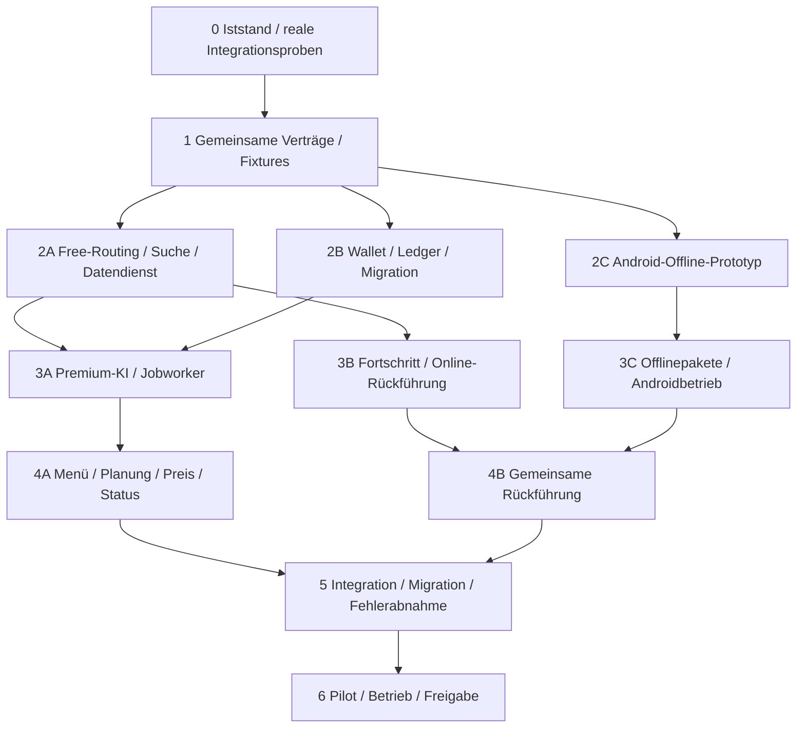

# Vollständiger Arbeitsplan: Routenplanung und Navigation

Stand: 28.10.2026. Ausgangsbasis: Commit `8447969`. Status aller nachstehenden Arbeitspakete: **geplant, nicht umgesetzt**. Architekturvertrag: [ROUTING_AI_ARCHITECTURE_PLAN.md](ROUTING_AI_ARCHITECTURE_PLAN.md), Version 3. Dieser Plan umfasst Routing, erforderliche Walletarbeit, Suche, Android-Offline und Navigation. Weitere Spiele, Partnerangebote und Belohnungsquellen folgen dem separaten [Gamificationplan](GAMIFICATION_REALITY_AND_ROADMAP.md).

## 1. Verbindliches Ergebnis und Arbeitsregeln

Nach erfolgreicher Umsetzung kann ein Nutzer ein echtes Suchziel finden, kostenlos mit BRouter routen, bewusst eine von der KI persönlich geplante Strecke kaufen und auf Android bei Abweichung auch ohne Netz kostenlos zur verbleibenden Strecke zurückgeführt werden. Ziel und Pflichtstopps bleiben erhalten. Fehler liefern keinen scheinbaren Navigationserfolg. Eine verlorene Antwort belastet das Konto nicht erneut.

- Zunächst nur diesen Plan reviewen. Keine Implementierung, Downloads großer Graphdaten, Cloudressourcen oder Veröffentlichung durch das Erstellen dieses Dokuments.
- Für spätere Umsetzung eigener Arbeitsbranch/Worktree vom dann geprüften Stand. Vor jeder Phase Status und fremde Änderungen berücksichtigen; vorhandene `.artifacts/` nicht pauschal committen oder löschen.
- Getrennte kleine Commits je abgeschlossener Arbeitseinheit; produktive Freigabe erst nach den Gates. Kein Push/Deploy als stiller Nebenschritt einer lokalen Prüfung.
- Codebesitz bei Parallelität vorher zuweisen. Gemeinsame Typen nur in Phase 1 gemeinsam ändern; Backend/Android/UI arbeiten danach gegen diesen Vertrag. Änderungen an `App.tsx`, zentralen Exporten und Regeln werden durch einen Integrationsverantwortlichen zusammengeführt. Andere Änderungen nicht zurücksetzen.
- Parallelität bleibt auf tatsächlich unabhängige Arbeiten beschränkt. Der Plan erlaubt Parallelspuren; er beauftragt für diese Dokumentarbeit keinen zusätzlichen Agenten.
- Für jedes Paket protokollieren: Commit, relevante Prüfung, tatsächliches Ergebnis, verbleibende Einschränkung. Keine Coverage für Dokumente und keine erfundenen Geräte-/Providerprüfungen.

## 2. Phasen, Abhängigkeiten und Parallelität

| Phase | Vorbedingung | Sinnvoll parallel | Gemeinsames Gate |
| --- | --- | --- | --- |
| 0 | Keine | Kleine getrennte Bestandsprüfungen | Reale Ausgangslage und Integrationsrisiken dokumentiert |
| 1 | Phase 0 | Keine konkurrierenden Vertragsentwürfe | Typen, Zustände, Preisregeln und Fixtures eingefroren |
| 2A / 2B / 2C | Phase 1 | Ja; verschiedene Dateien/Verantwortungen | Free-Dienst, Walletbeweis bzw. native Machbarkeit |
| 3A / 3B / 3C | Jeweilige Vorbedingungen laut Diagramm | Ja; Premiumbackend, Navigation und Android getrennt | Premium korrekt, Rückführung zieltreu, Offline belastbar |
| 4A / 4B | Abhängige Phase-3-Gates | Ja; Planungskomponenten und Navigationsintegration getrennt | Alle Oberflächen verwenden dieselbe Logik |
| 5 | Beide Phase-4-Gates und 2B | Prüfungen teilweise parallel; Migration sequenziell | Keine offenen kritischen Fehler oder ungeklärten Geld-/Navigationspfade |
| 6 | Phase 5 | Auswertung und Dokumentation parallel | Nachweisbarer Pilot und explizite Betriebsfreigabe |

Verbindliche Wellenplanung für zwei Bearbeiter: 0 und 1 sequenziell; dann 2A + 2C parallel; danach 2B + 3B parallel; danach 3A + 3C parallel; danach 4A + 4B parallel; abschließend 5 und 6 mit ihren Freigabegates. So ist die native Machbarkeit früh geklärt. Innerhalb einer Welle darf eine bereits erfüllte unabhängige Folgearbeit einen freien Bearbeiter nutzen; Vertrags- und Integrationsgate bleiben bindend. Unabhängige vorbereitende UI-Arbeit kann mit Fixtures beginnen; produktive Verdrahtung wartet auf die jeweiligen Backendverträge.

## 3. Phase 0 — Bestand sichern und Risiken mit echten Antworten auflösen

**Verantwortung:** Integration/Architektur. **Ergebnis:** kurze Bestandsnotiz, echte anonymisierte Fixtures und reproduzierbare Probeprotokolle.

- **0.1 Ausgangsstand:** Branch, Worktree, Gitstatus, letzte Commits, verfügbare Node-/Java-/Androidversionen und vorhandene Skripte erfassen. Lokale Änderungen sichern; keine Abhängigkeiten ungefragt aktualisieren. Funktionsstatus des früheren Pushs separat prüfen, sobald Netzwerk verfügbar ist.
- **0.2 Aufrufinventar:** Alle Einstiege für Heute-Tour, Suche, Ziel-/Stationsplanung, GPX-Import, manuelles und automatisches Rerouting erfassen; dazu alle Guthaben-/Unlimited-/Subscriptionleser und -schreiber. Auch die Browser-Firebase-AI-Adapter und den alten `computeRoute` als mögliche Umgehungswege prüfen.
- **0.3 Routerprobe:** Mit unpersönlichen Testkoordinaten in der Pilotregion eine Punkt-zu-Punkt-Route und eine Via-Route gegen die gewählte BRouterversion erzeugen. Tatsächliche Felder für Geometrie, Höhen, Wegattribute und Manöver dokumentieren. APIparameter und native Aufrufsignaturen aus der gepinnten Version übernehmen; keine JSON-Felder raten.
- **0.4 Providerprobe:** Verfügbarkeit des vorgesehenen stabilen Modells, Google-Gen-AI-SDK-Typen, strukturiertes Antwortformat, `europe-west3`, Projektberechtigung und aktuellen Preis prüfen. Erst bei später autorisierter Umsetzung einen minimalen bezahlten Probeaufruf verwenden. Kein automatischer Regions-/Modell-/Cloudwechsel bei Fehlern. Scheitert die Vorgabe, ist Premium blockiert und die genaue Ursache wird zur Entscheidung vorgelegt.
- **0.5 Betriebs-/Datenprobe:** Eigene BRouter-/Nominatim-Instanzen als neue Komponenten ausweisen, regionale OSM-/Graphimporte und Quellenlizenzen dokumentieren, tatsächlich erforderliche CPU/RAM/Datenträger messen. Pilotdaten auf Berlin/Brandenburg begrenzen und unterstützte Abdeckung offen ausweisen. Upstream- und App-Lizenzen ohne ungeprüfte Konformitätszusage aufnehmen.
- **0.6 Ausgangsmessung:** Relevante bestehende Prüfungen einmal ausführen und Ergebnisse/echte Warnungen festhalten; keine alten Testzahlen als neue Messung übernehmen. Fehlende Emulator-, SDK- oder Gerätetauglichkeit konkret benennen.

**Gate 0:** Es gibt echte dokumentierte Datenverträge für Router/Manöver und einen belegten Weg zur Modellanbindung. Netzwerk-/Kontoblocker sind sichtbar. Ohne Providerzugriff dürfen nachfolgende Offline-/Unit-/Vertragsarbeiten fortfahren; Premium darf dadurch noch nicht live werden.

## 4. Phase 1 — Gemeinsame Verträge und Zustände festlegen

**Verantwortung:** Integration. **Besitz:** gemeinsames Routingvertragsmodul, bestehende Navigationstypen und Adaptergrenzen. **Voraussetzung:** Gate 0 für die betroffenen Komponenten.

- **1.1 Typen:** `RouteRequestV1`, Kriterien und Profil-Snapshot, Standortquelle/-zeit/-genauigkeit, `RouteCandidateV1`, `ValidatedRouteV1`, Manöver, Qualitätsmetrik und `NavigationSessionV1` implementieren. Interne benannte Koordinaten und SI-Einheiten; Legacyarray nur am Rendereradapter.
- **1.2 Produktmodi:** `planning: standard|ai` von Ausführung `online|local` trennen. Zielroute und Rundtour separat ausdrücken. Preis-/Abo-/Offlinefähigkeit nicht aus Profilpräferenzen ableiten. Alte `premium|offline`-Signaturen gezielt übergangsweise adaptieren, danach entfernen.
- **1.3 Zustände:** Planungsentwurf/Vorschau getrennt von aktiver Navigation halten. Asynchrone Ergebnisse an Auftrags-, Auth- und Consentgeneration binden. `AbortController` bis zu jedem abbrechbaren Upstream durchreichen; serverseitige Arbeit explizit canceln.
- **1.4 Fehler und Fähigkeiten:** Stabile Fehlercodes aus der Architektur definieren. Capabilityantwort gibt Abdeckung, unterstützte Kriterien/Profile, lokale Engine und Preisversion an. UI erhält typisierte Zustände statt allgemeiner Alerts.
- **1.5 Fixtures/Vertragstests:** Echte Routerantworten klein und unpersönlich speichern; Grenzfälle mit vertauschten Koordinaten, ungültigen Zahlen, fehlenden Eigenschaften, ausgedünnter/verdichteter Linie und Via-Reihenfolge ergänzen. Geteiltes Vertragsmodul muss im Frontend- und Functions-Build verwendbar sein.

**Gate 1:** Produzenten und Konsumenten kompilieren gegen denselben Vertrag. Ein unvalidierter Korridor kann nicht versehentlich den Navigationsstartvertrag erfüllen. Keine Änderung an gemeinsamem Vertrag außerhalb einer abgestimmten Integration.

## 5. Phase 2A — Kostenlose reale Routen, Suche und Datengrundlage

**Verantwortung:** Routing-/Datenbackend. **Besitz:** Free-Routeradapter, Validierung, Suche, POI-Import, Infrastrukturdefinitionen. **Voraussetzung:** Gate 1. Parallel zu 2B/2C möglich.

- **2A.1 Betreiberdienste:** Gepinnten BRouterdienst mit privaten Backendzugängen, erlaubten Profilen und versionierten Segmentdaten vorbereiten. Nominatim/PostGIS regional importieren, getrennte Datenvolumes und Backups konfigurieren. BRouterprofile und POIabdeckung in einer Registry führen. Größen anhand Phase-0-Messungen festschreiben.
- **2A.2 Kostenlose API:** `computeFreeRoute` mit App Check, Konto optional, Eingabegrenzen, Ratenbegrenzung, Timeout und 0 Token. Benutzer darf weder URL noch Profilcode vorgeben. Loggeometrien/Querystrings am Proxy abschalten oder redigieren.
- **2A.3 Ziel und Via:** Standardroute exakt vom bestätigten Start durch geordnete Pflichtstopps zum Ziel berechnen. Ladestation verwendet denselben Zielvertrag. Keine nachträgliche Manipulation des letzten Linienpunkts. Snapdistanz und unerreichbare Ziele verständlich ausgeben.
- **2A.4 Rundtour:** Netzverbundene echte Anker oder nachgewiesene Rundtourfunktion einsetzen; Kandidaten nach tatsächlicher Distanz und Anteil wiederholter Kanten bewerten. Wunschdistanz ±20 Prozent; bei Nichterfüllung Fehler mit Anpassungsmöglichkeit. Keine Kreislinie als Ersatz.
- **2A.5 Validierung/Metriken:** Geometriegrenzen, Start/Ziel/Via, Länge, vollständige Verbindungen, Kriterien und tatsächliche Manöver prüfen. Höhenabstandsprofil und Quellenqualität implementieren. Fehlende Zusatzdaten bleiben unbekannt. Kostenlose Trackplanung darf bei fehlender optionaler Höhendatenquelle funktionieren.
- **2A.6 Suche:** Betreiber-`searchPlaces`, Suche nur nach bewusstem Absenden, maximal 5 Ergebnisse, Generation/Abort und kein Überschreiben durch alte Antworten. Keine öffentliche Nominatim-Autocompleteanbindung. Koordinaten-/Kartenwahl und gespeicherte Orte erlauben Planung ohne neue Online-Adresssuche.
- **2A.7 POIs:** Regionalen, räumlich indizierten Katalog aus OSM-Import erzeugen. Communityeinträge nach Vertrauensstatus kennzeichnen; Öffnung, Kompatibilität, Quellenstand und unbekannte Merkmale mitführen. Begrenzte räumliche Abfrage statt vollständigem Stationsdownload je Premiumjob.
- **2A.8 Alte Fallbacks:** Synthetische Kreise, Direktlinien, feste Oberflächen, erfundene Ladehalte und nicht belegte Aussagen aus allen startbaren Routenpfaden entfernen. Den bisherigen OSRM-Fallback ohne nachgewiesenes Fahrradgraphprofil schließen. Orientierungslinien nur als separaten nicht navigierbaren Anzeigetyp erhalten, wenn überhaupt benötigt.

- **2A.9 Früher nutzbarer Freefluss:** Integration verdrahtet bereits jetzt Suche, kostenlose Ziel-/Stationsplanung und Fehlerzustände in der vorhandenen Oberfläche. Dieser kleine Eingriff in zentrale Appdateien wird sequenziell zusammengeführt; Premium bleibt bis 3A deaktiviert. Die spätere Phase 4A ergänzt die vollständige Kauf-/Premium-UX. So wartet die kostenlose Routenfunktion nicht auf die KI-Implementierung.

**Abnahme 2A:** Zielsuche → Auswahl → kostenlose Berechnung liefert auf echten Pilotdaten eine zusammenhängende Strecke mit korrektem Ziel und Manövern. HTTPfehler, leere Ergebnisse, ungültiges JSON, fehlende Graphteile, Timeouts oder Consentwiderruf erzeugen keine neue startbare Route. Wiederholung als Free verändert nie die Wallet.

## 6. Phase 2B — Ledger, Reservierung und Kontomigration

**Verantwortung:** Wallet-/Sicherheitsbackend. **Besitz:** Ledger, sämtliche Guthabenschreiber, Firestore-Regeln und Löschworkflow. **Voraussetzung:** Gate 1. Parallel zu 2A/2C möglich.

- **2B.1 Bestandsaufnahme:** Vorhandene Konten und Writer auf vollständige Integer-/Grenzprüfung prüfen. Ungültige Altwerte als Migrationsfehler isolieren; keine erfundenen Startguthaben. Migrationslauf zuerst read-only und mit Anzahl/Saldensumme protokollieren.
- **2B.2 Schema/Helfer:** `balance` als verfügbaren Saldo, `reservedBalance` als gebundenen Saldo, Kontoschemaversion und Ledgerbelege einführen. Atomare Operationen `credit`, `reserve`, `capture`, `release`, `spend`, `refund` mit deterministischen Referenzen implementieren. Keine Provideroperation in einer Firestore-Transaktion.
- **2B.3 Alle Writer:** Quiz, Rad, Gutschein und Admin-/Korrekturpfade auf denselben Helfer umstellen. Routen-Flatrate darf keine Gutscheine freistellen. Clientpräferenz `unlimitedDemandActive` aus jeder Autorisierungsentscheidung entfernen; tatsächliche Aboberechtigung nur serverseitig prüfen.
- **2B.4 Regeln:** Client darf Konto/Ledger/Jobzustand weder erzeugen, ändern noch löschen. Benutzerlesezugriff nur eigener Kontostand und passende Belege. Auch Dokumentersatz, Nullwerte, fremde UID und direkte Löschungen testen.
- **2B.5 Migration:** Neue kompatible Writer zunächst geschlossen ausrollen, kurze Schreibpause aller Tokenmutationen setzen, pro Konto atomar Eröffnungsbeleg und Version erzeugen, Salden/Beleganzahl abgleichen und erst dann freischalten. Wiederholung erkennt bereits migrierte Konten. Kein alter Writer darf zwischen Snapshot und Umstellung Guthaben verändern.
- **2B.6 Löschung:** Kontolöschung mit Sperrmarke, Stop neuer Jobs, Reservierungsabschluss und Retryfester Daten-/Artefaktlöschung erweitern. Rückkehr eines verspäteten Workers darf gelöschtes Konto nicht erneut erzeugen. Aufbewahrungsregeln aus Architektur auch für neue Sammlungen implementieren.
- **2B.7 Tests:** Emulatorfälle für parallele Reservierung/Gutschein/Earn, Abbruch während Abschluss, Überlauf/Negativwerte, Kontosperre/-löschung, doppelte Belege und Migrationswiederholung. Kritische Geld-/Authpfade gezielt mit Mutationen prüfen; überlebende relevante Mutationen auflösen.

**Abnahme 2B:** In jedem Szenario bleiben beide Salden nichtnegativ und zu Belegen konsistent. Reservierung verhindert andere Ausgaben derselben Token. Kein direkter Client kann Guthaben oder Reservierung löschen/ändern. Nach Absturz und Wiederholung entstehen weder Gratisguthaben noch Doppelabbuchung.

## 7. Phase 2C — Früher Android-Offline-Prototyp

**Verantwortung:** Native Android. **Besitz:** Native Capacitor-Bridge und kleines Testharness, keine Änderungen am zentralen Routingvertrag. **Voraussetzung:** Gate 1. Parallel zu 2A/2B möglich.

- **2C.1 Engine:** Gepinnten BRouter-Javakern mit erforderlichen Modulen und Lizenzen in Android einbinden. Die konkreten Klassen/Signaturen aus der gepinnten Version übernehmen. Separate Berechnung ohne UI-Thread, ohne freien Profilcode und ohne notwendige fremde App.
- **2C.2 Testdaten:** Kleinste benötigte originale/selbst erzeugte kompatible Segmentmenge des Pilotgebiets mit Profil/Lookup verwenden. Tatsächliche Bytegröße nennen; keine willkürlichen zugeschnittenen `.rd5`-Dateien. Große Downloads erst im Rahmen der späteren Umsetzung und bewussten Datenauswahl.
- **2C.3 Flugmodus:** Punkt-zu-Punkt, Pflichtvia, unerreichbarer Punkt und eine Rückführung auf Originalroute rechnen. Sämtliche Netzwerkrequests mitschneiden: Route und Manöver müssen tatsächlich aus lokalen Daten kommen.
- **2C.4 Lebenszyklus:** Timeout, Abbruch, fehlende/beschädigte/inkompatible Segmente, parallele Bridgeaufrufe und Prozessneustart prüfen. Ein lokaler Auftrag gleichzeitig. Speicher und UIreaktion messen.
- **2C.5 Machbarkeitsgrenzen:** Auf einem physischen Androidgerät mit 4 GB RAM mindestens 20 Pilotfälle prüfen. Zielwerte: normale Rückführung p95 ≤10 s, Peakprozessspeicher ≤512 MiB; kein UI-Block über 100 ms durch Routerarbeit. Werte sind Abnahmeziele, keine vorliegenden Messergebnisse. Bei Überschreitung zuerst Kandidaten-/Speichergrenzen optimieren; kein stiller Enginewechsel.

**Abnahme 2C:** Reale lokale Strecke und Manöver im Flugmodus, reproduzierbarer Cancel und klare Fehler bei fehlender Abdeckung. Scheitert das Gate, Offlinefunktion gesperrt lassen und genaue technische Entscheidung vor weiterem Paketbau melden. Online-/Premiumarbeiten können unabhängig weitergehen.

## 8. Phase 3A — Persönliche KI, persistente Jobs und einmalige Abrechnung

**Verantwortung:** Premiumbackend. **Besitz:** Modell-/Planeradapter, Auftragsdienste, Worker/Outbox und private Artefakte. **Voraussetzung:** 2A + 2B sowie tatsächliche Modellprobe aus Phase 0.

- **3A.1 Preis/Berechtigung:** `quotePremiumRoute` mit 5-Minuten-Angebot, Requesthash und Default 1 Token; erweiterten Modus und explizite Routen-Flatrate prüfen. Keine Preisangabe aus dem Browser übernehmen. Bei Annahme Preis/gewöhnlichen Aboablauf für den kurzen Job fixieren; explizite Konto-/Betrugssperre vor Abschluss erzwingt Release. Nicht unterstützte harte Bedingungen vor Reservierung zurückweisen.
- **3A.2 Auftrag:** `createPremiumRoute` erzeugt Walletreservierung, Job und Outbox atomar. Bestehenden Idempotenzschlüssel zuerst nachschlagen: existierendes Ergebnis bleibt auch nach Angebotablauf abrufbar, ohne erneute Quoteprüfung/Buchung. Bei neuem Schlüssel muss das Angebot aktuell und zur Anfrage passend sein. Ein aktiver Job pro UID.
- **3A.3 Dispatcher/Lease:** Deterministische Cloud-Task-Zustellung, Reparatur nicht zugestellter Outbox, aktuelle Workerlease/Generation und maximal 3 Zustellversuche innerhalb der 180-s-Deadline. Queueparallelität 2; verspätete Worker können nicht abschließen. Leaseheartbeat darf Deadline nicht verlängern.
- **3A.4 Reale KI-Planung:** Bestätigten Profil-Snapshot und maximal 40 reale POIs laden. Erster strukturierter Modellaufruf erzeugt bis zu 3 Kandidatenpläne aus zulässigen Profilen/Orts-IDs. Router berechnet; gemeinsamer Validator verwirft harte Verstöße. Zweite fachliche Modellphase bewertet nur verbliebene Kandidaten und erklärt mit belegbaren Fakten die persönliche Auswahl. Maximal 4 physische Provideranfragen pro Job gemäß Architektur, persistente Versuchszähler vor jedem Aufruf, wiederverwendbare Phasenergebnisse und keine versteckten SDK-Retries.
- **3A.5 Qualität:** `planningEvidence` dokumentiert Kriterien → Profile/Anker/Kandidatenwahl. Keine geheimen Gedankengänge speichern; nur überprüfbare Entscheidungen und Faktenreferenzen. Bei identischen Strecken deduplizieren. Fehlendes echtes KI-Ergebnis oder unverifizierbare harte Bedingung zählt nicht als erfolgreicher Premiumauftrag.
- **3A.6 Ergebnisabschluss:** Artefakt privat und unveränderlich speichern, Hash prüfen, danach in einer Transaktion Job auf `ready` setzen und Reservierung capturen. Pointer erst nach Abschluss für Besitzer freigeben. Fehlgeschlagene Speicher-/Commitversuche hinterlassen höchstens unzugängliche aufräumbare Objekte. Jedes gültige Ergebnis und sämtliche gültigen Alternativen automatisch dauerhaft archivieren, bevor `ready`/Capture sichtbar wird. Archivierung ist kein späterer manueller Clientschritt. Keine 24-h-Löschung erfolgreicher Strecken; Wiederholung/Abruf über `savePremiumRouteResult` bleibt idempotent und bezahlt nicht erneut.
- **3A.7 Abbruch/Recovery:** Cancel-/Abschlussrennen, abgelaufene Jobs und 15-Minuten-Reservegrenze implementieren. Minütlicher Sweeper erledigt tatsächliche Freigabe; TTL nur für spätere Datenlöschung. Nach verlorener Antwort/Neustart Jobstatus fortsetzen. Serverseitig nachgewiesener Artefaktschaden hat einen idempotenten Refundpfad.
- **3A.8 Sicherheit/Budgets:** UID/App Check/Sperre bei Endpunkten, Ausgabe und Abschluss; aktuelle Consentversion; Modell-/Profilerlaubnislisten; Eingabe-/Ausgabelimits und Pilotproviderbudget aus Architektur mit konservativer Budgetreservierung pro physischem Versuch und geschlossenem Umgang mit unbekanntem Providerverbrauch. Neue Jobs bei Kill-Switch oder erschöpftem Budget geschlossen halten. Providerkosten bei Wiederholungen erfassen; keine Zusage genau einmaliger externer Inferenz.
- **3A.9 Alte Wege:** `computeRoute` als Stub schließen/entfernen, sobald seine echten Aufrufer migriert sind. Browserbeschreibung und allgemeiner Chat dürfen keinen Premiumstatus oder Gratis-Premiumroute ausstellen. Alte Modelldefaults im betroffenen Routingpfad ersetzen; nicht pauschal fachfremde KI-Funktionen umbauen.

**Abnahme 3A:** Unterschiedliche bestätigte Wünsche beeinflussen nachweisbar Planung/Auswahl. Persönliche Planung mit gleicher optimaler Geometrie bleibt möglich, benötigt aber Planungsbeleg. Maximal eine Nutzerbuchung trotz Retry, Cancelrennen, Workerduplikat und verlorener Antwort. Fehler vor `ready` geben reservierte Token zurück. Modell- und Regionprobe sind wirklich erfolgt.

## 9. Phase 3B — Fortschritt und kostenlose Online-Rückführung

**Verantwortung:** Navigationslogik. **Besitz:** Tracker, Fortschritt, Rückführungsplaner und Manövernormalisierung. **Voraussetzung:** 2A; vereinbarter Vertrag aus Phase 1.

- **3B.1 Trackverfolgung:** Segmentprojektion und räumlichen Index einführen. Fortschrittsfenster, Streckendistanz und Reihenfolge erreichter Pflichtstopps halten. Selbstkreuzung, Start=Ende und parallele Streckenäste dürfen keinen Sprung zum Fahrtende auslösen.
- **3B.2 Messqualität:** Zeitstempel/Genauigkeit bis zum Tracker geben. Die Zeit-/Distanzhysterese aus Architektur mit mindestens drei brauchbaren Positionen umsetzen. Tunnel, Stillstand, Positionssprünge und schlechte Genauigkeit führen zu Unsicherheit statt Requeststurm. Ankunft braucht Endfortschritt plus Nähe zum echten Ziel; nicht Nähe zum Rundtourstart allein.
- **3B.3 Manöver:** Echte Routermanöver an Geometrie/Fortschritt binden. Erfundenen Straßennamen und winkelerfundene Straßenzuordnung entfernen. Ansage-IDs an Manöver und Route binden, damit wiederholte Kurven derselben Richtung nicht versehentlich stumm bleiben.
- **3B.4 Rejoin:** Höchstens 5 vorausliegende Eintrittskandidaten vor dem nächsten Pflichtstopp prüfen, tatsächliche kostenlose BRouterverbindungen vergleichen, beste erlaubte Verbindung mit Originalrest verbinden und validieren. Originalziel/-auftrag beibehalten. Nicht erreichbare Kandidaten und Graphlücken sauber behandeln.
- **3B.5 Steuerung:** Genau ein Auftrag und eine Generation, 20 s Sperrzeit, automatisches Übernehmen gültiger Rückführung mit Ansage, Pause/Abbruch möglich. Kein Modellerzeugungs-/Walletendpunkt auf diesem Pfad. Ältere Antworten dürfen neue Session nicht überschreiben.

**Abnahme 3B:** Ein aufgezeichneter Abweichungstrack führt zurück zur richtigen verbleibenden Route und weiter zum ursprünglichen Ziel. Pflichtstopps werden nicht übersprungen. Netzfehler erhalten die Originalroute und pausieren nur unbelegte Anweisungen. Viele GPSupdates erzeugen begrenzte kostenlose Requests.

## 10. Phase 3C — Offlinepakete und belastbare Androidnavigation

**Verantwortung:** Native Android/Paketdienst. **Besitz:** Paketmanifest/-download, appprivate Daten, nativer Navigationslebenszyklus. **Voraussetzung:** 2C bestanden. Parallel zu 3A/3B möglich.

- **3C.1 Pakete:** Signierte Manifestversion mit Engine/Lookup/Profil/Graphkompatibilität, Abdeckung, Datum, Größen und SHA-256; zugehörige erlaubte Basiskartendaten gesondert kennzeichnen. Datenimport und reproduzierbaren Manifestbuild dokumentieren.
- **3C.2 Download:** Explizite Regionswahl, echte Größe und Speicherbedarf zeigen, fortsetzbare Downloads, Prüfung, atomare Aktivierung, Rückfall auf alte Version, Lösch-/Updatepfad. Keine Aktivierung halbgeladener oder nur teilweise kompatibler Daten.
- **3C.3 Abdeckung:** Fehlende benachbarte Segmente, Inseln, Start/Ziel innerhalb derselben Boundingbox bei fehlendem Umweggraph und Paketgrenzen testen. Aktive Fahrt pinnt eine Version; Löschung/Update serialisieren.
- **3C.4 Session:** Originalroute und Manöver für Offlinefahrt lokal halten. Androidschlüssel aus Keystore für private Sessiondaten; öffentliche Kartendaten getrennt. Crashsicher speichern; Fortsetzung nach Neustart nur bewusst und mit frischer Position.
- **3C.5 Hintergrundbetrieb:** Nutzerstart im Vordergrund, benötigte Location-/Foreground-Service-Berechtigungen, sichtbare Navigationsbenachrichtigung und Ende der Ortung bei Fahrtende/Widerruf. Bildschirm aus, Apphintergrund, Akkuoptimierung und Berechtigungsentzug auf echtem Gerät prüfen. Keine unbelegte Webtimerlösung.
- **3C.6 Fähigkeitsanzeige:** Web/iOS bekommen ehrlichen fehlenden lokalen Routerstatus. Android zeigt verwendbares Paket und Datenstand. Ohne lokale Adressdaten nur Kartenwahl, Koordinaten oder gespeicherte Orte anbieten.

**Abnahme 3C:** Downloadunterbrechung, Updateabbruch und Dateikorruption beschädigen keine zuletzt funktionierende Paketversion. Mit Netz vollständig aus bleiben Originalroute, Manöver und lokale Berechnung nutzbar. Ortung endet tatsächlich bei Fahrtende und Widerruf.

## 11. Phase 4A — Menüs und sämtliche Planungseinstiege integrieren

**Verantwortung:** Frontend/Planung. **Besitz:** Startseite, Suche, erweiterter Planer, Preis-/Job-/Vorschauansichten. Zentrale `App.tsx`-Integration durch einen Verantwortlichen. **Voraussetzung:** 3A; UIarbeit gegen Fixtures vorher möglich.

- **4A.1 Hauptmenü:** Eigene reine Menüansicht erhalten. Reihenfolge: KI heute Strecke, Einfache Routenplanung, Erweiterte Routenplanung (Premium). Keine Hintergrundroutenerzeugung und kein Tokenverbrauch beim Start/Öffnen.
- **4A.2 Einfach:** Karte öffnen und Suchfeld im Rahmen der Nutzeraktion fokussieren; explizite Suche, Ergebnisauswahl und sichtbarer Zielmarker. Kostenlose BRouterplanung und KI-Premium klar getrennt; Offlineoption nur nach Capability/Paketstatus. GPSfehler erlauben manuelle Startwahl, nicht still Berlin als Fahrtstart.
- **4A.3 Erweitert:** Geordnete Pflichtstopps, optionale Interessen, Wünsche, Oberflächen-/Steigungswünsche und aktiv gewählte Profilfelder anzeigen. Konflikte/fehlende Daten vor Kauf verständlich erklären. Editierbare Profile behaupten keine Aboberechtigung.
- **4A.4 Heute-Tour:** Bewusst gestarteter Premium-Rundtourauftrag mit Distanz/Thema und sichtbarer Datenauswahl. Vorhandene Speicherpräferenzen sind editierbar; keine fest erfundenen Badeseen/Ladepunkte.
- **4A.5 Kauf/Job:** Preisangebot zeigen, Zustimmung und Start, lokal persistierten Schlüssel verwenden. `queued/running/ready` und bestätigten oder nur vorgemerkten Abbruch unterscheiden. Kein neuer Schlüssel bei bloßem Netzwerkretry. Abrechnung bei bereitgestelltem Ergebnis vor dem Start erklären.
- **4A.6 Vorschau:** Persönliche Planungsgründe, erfüllte/unsichere Kriterien, echte Metriken und Alternativen zeigen. Nur gültige Route darf Navigation starten. Neue Vorschau ersetzt laufende Fahrt erst beim Übernehmen.
- **4A.7 Race-/Fehlerzustände:** Ausloggen, Konto-/Consentwechsel, Cancel, Doppelklick, Suche-alt-vs-neu und Seitenwechsel testen. Fremde Kontostände oder verspätete Ergebnisse erscheinen nicht im neuen Konto.
- **4A.8 Mobilbedienung:** Tastatur, Safe Areas, kleine Displays, Navigation unten, Rückführungsstatus und Planungskarten gemeinsam prüfen. Alle Buttons haben sichtbaren Zustand und konkrete Fehlerreaktion; keine überlagerte oder unsichtbare Hauptaktion.

**Abnahme 4A:** Jeder Einstieg führt über denselben passenden Vertrag zu einer echten Route oder verständlichem Fehler. Keine Funktion verkauft einen Text oder Korridor als Premiumroute. Kein Menübesuch bucht Token.

## 12. Phase 4B — Online-/Offline-Rückführung zusammenführen

**Verantwortung:** Navigation/Integration. **Besitz:** `NavigationSession`, Routingentscheidung und Androidbridgeanbindung. **Voraussetzung:** 3B + 3C; gemeinsame Vertragsintegration sequenziell.

- **4B.1 Ausführung wählen:** Nutzbares lokales Paket bevorzugen, sonst online kostenlos BRouter bei gültiger Übermittlungszustimmung. Tatsächliche Router-/Netzfehler behandeln, nicht allein `navigator.onLine` vertrauen.
- **4B.2 Verbindung erhalten:** Originalroute, Fortschritt und Pflichtstopps durch Rückführung erhalten. Bei Abweichung von der Rückführung erneut unter derselben Sperrzeitlogik berechnen. Nach Wiedereintritt Verbindung verwerfen, Originalrest weiterfahren.
- **4B.3 Ausfälle:** Keine Abdeckung/kein Eintrittspunkt: Originalroute und Position anzeigen, unbelegte Abbiegungen pausieren, manuelle Pause und spätere Rückführung anbieten. Keine neue Straßenverbindung zum letzten Punkt erfinden.
- **4B.4 Netzwiederkehr:** Noch nötige kostenlose Rückführung fortsetzen; kein KI-Kauf, kein heimlicher Tourwechsel. Laufender lokaler Auftrag wird nicht durch parallel gestarteten Onlineauftrag überschrieben.
- **4B.5 Neustart/Widerruf:** Session nach Kill/Neustart kontrolliert wieder aufnehmen; frische Position verlangen. Bei Widerruf native Ortung, laufende Route-/Paketarbeit mit sensiblen Daten und Ansagen beenden, private Session löschen; auch heruntergeladene Offlinepakete und routenbezogene Caches gemäß der umfassenden lokalen Löschzusage entfernen. Erfolgsmeldung erst nach bestätigter Bereinigung; Teilfehler konkret melden.

**Abnahme 4B:** Flugmodus während Premiumfahrt → Abweichung → lokale Verbindung → Originalroute → Ziel gelingt auf echtem Androidgerät ohne Token-/KI-Netzaufruf. Abdeckungslücke bleibt ehrlich sichtbar. Kein Pflichtstoppverlust bei wiederholter Abweichung oder Neustart.

## 13. Phase 5 — Zusammenhängende Abnahme und Migration

**Verantwortung:** Integration mit getrenntem Wallet-/Navigationsreview. **Voraussetzung:** 4A + 4B + 2B. Tests gezielt, keine breite Wiederholung ohne neue Änderung oder offenen Fehler.

| Testgruppe | Verbindliche Fälle | Erfolgskriterium |
| --- | --- | --- |
| Suche/Start | Keine Treffer, alte Antwort nach neuer Suche, ungültige Koordinate, fehlendes GPS, manueller Start, Tastatur auf kleinem Display | Ziel/Start werden korrekt übernommen; kein stiller Ersatzort oder wirkungsloser Button |
| Free | Ziel/Vias, Rundtour, Station, Routertimeout, falsches JSON, fehlende Manöver/Höhen, Profil/Abdeckung falsch | Reale Geometrie und ehrlicher Funktionsumfang; immer 0 Token |
| Premiumqualität | Gleicher Start mit Asphalt-/Naturwunsch, Pflichtstopps, harte Konflikte, unbekannter Akku, 0 Prozent Akku, fehlende Daten, ein gültiger Kandidat | Persönlicher Planungsbeleg; keine erfundenen Fakten; harte Verstöße kein Kaufabschluss |
| Wallet/Jobs | Doppelstart, Retry, Antwortverlust, Cancel kurz vor/nach `ready`, Taskduplikat, verlorene Outboxzustellung, Workerabsturz nach Upload, Deadline/Sweeper, normaler Aboablauf, Ergebnisablauf und ausdrückliches Speichern | Genau ein Capture oder Release, keine negativen Salden und keine fällige offene Reserve nach Wiederherstellung |
| Parallelgeld | Earn + Gutschein + Premiumreserve/Cancel, Kontolöschung/-sperre, Überlauf, direktes Konto-/Joblöschen | Belege und Salden stimmen; kein clientseitiger Ausweg |
| Tracking | Gerade mit wenigen Punkten, dichte Linie, GPSrauschen, Tunnel, Schleife, Selbstkreuzung, paralleler Radweg, Brücke/Fluss, wiederholte gleichartige Kurven | Kein falscher Ast/Ankunft/Manöver; begrenzte Rückführungsrequests |
| Offline | Flugmodus, fehlendes Segment, Paketgrenze, beschädigtes Update, knapper Speicher, mehrfaches Abweichen, kein erreichbarer Eintrittspunkt | Lokale Berechnung oder klarer Fehler; Originalauftrag bleibt erhalten |
| Lifecycle | Bildschirm aus, Apphintergrund/-kill, Neustart, Auth-/Consentwechsel, OSberechtigung entzogen | Kontrollierte Fortsetzung oder Stopp; keine heimliche Ortung/Übernahme |
| Schutz/Betrieb | Fremde UID/Artefakt-ID, manipuliertes Angebot/Profil, Prompt Injection in POItext, Budgetgrenze, Kill-Switch, alter Client | Kein Berechtigungs-/Preis-/Datenabfluss; keine verdeckte Ersatzroute |

- **5.1 Automatisiert:** Vorhandene Vitest-/Functions-/Emulatorskripte nutzen und passende neue Prüfungen für die tatsächlichen Invarianten ergänzen. Routingvertrags-/Geometrietests, reale Adapterfixtures, Wallet-/Jobkonkurrenzfälle und Frontendflüsse kombinieren. Keine reine Mockabnahme für Daten- oder Geldverhalten.
- **5.2 Kritische Abnahme:** Für Ledger, Auth und Jobabschluss relevante Zweige messen und Mutationstests durchführen. Ziel gemäß persönlicher strenger Abnahme: ≥95 Prozent Abdeckung der kritischen Pfade; Zahlen tatsächlich aus Messung belegen. Kritische überlebende Mutation oder ungetestetes Cancelrennen blockiert die Freigabe.
- **5.3 Qualitätskorpus:** Mindestens 20 unpersönliche feste Fälle: je 4 Stadt-, Land-, hügelige, Via- und Rundtourfälle, jeweils passend zur ausgewiesenen Datenabdeckung. Präferenzen paarweise variieren und Planungs-/Kriterienbefunde vergleichen. KI muss nicht identischen Text liefern; harte Anforderungen und Abrechnung müssen deterministisch bleiben.
- **5.4 Geräte:** Web in aktuellem Chrome/Safari, Android auf physischem 4-GB-Gerät, iOS für Online-/Statusdarstellung auf realem Gerät oder ausdrücklich gekennzeichnetem Simulator. Android zusätzlich Display-aus-/Flugmodusfahrt. Nicht verfügbare Plattformprüfung als Freigabegrenze benennen.
- **5.5 Sicherheit/Wahrheit:** Keine Geheimnisse im Bundle; echte Modellantwort und Graphstrecke dürfen nicht durch Demo ersetzt sein. Backend-/Storage-/Firestore-Zugriff auf fremde IDs testen. Netzwerkbeobachtung bestätigt keine KI-Abfrage oder Tokenbuchung bei Rückführung.
- **5.6 Migration:** Erst auf Testkopie, dann mit freigegebenem Betriebsfenster; Nutzer-/Saldenzahlen und offene Jobs vorher/nachher vergleichen. Featureflag-/Regel-/Backendreihenfolge aus 2B einhalten. Private Altrouten bleiben als solche gekennzeichnet; keine Massenumdeutung.
- **5.7 Abschlusstest:** Je ein kompletter realer Free-, Premium-, Heute-Tour- und Advancedfluss sowie Online- und Offlineabweichung mit Nachweis von Ergebnis und Kontostand. Nach Fehlerkorrektur nur betroffene und abhängige Pfade erneut prüfen.

**Gate 5:** Alle relevanten Fälle bestanden; Produktionsressourcen/Modell/Manöver und Android-Offline wirklich nachgewiesen. Keine offenen kritischen Geld-, Datenschutz-, Zielverlust- oder Falschnavigationsfehler. Teilfreigabe Free/Online ist möglich, aber unbewiesene Premium-/Offlinefunktionen bleiben sichtbar deaktiviert.

## 14. Phase 6 — Kontrollierter Pilot und Betriebsfreigabe

**Verantwortung:** Integration/Betrieb. **Voraussetzung:** Gate 5 und autorisierte Betriebswerte.

- **6.1 Freigabereihenfolge:** Backend und Regeln kompatibel vorbereiten; zunächst Free/Betreibersuche im Pilot, dann Android-Offline/Rückführung, zuletzt Premium mit echten Token und Providerkosten. Alte Clients dürfen keinen unsicheren Writer oder Stub weiter benutzen.
- **6.2 Metriken:** Router-/Modellfehler, Validierungsfehler, Jobdauer, Kosten, einmalige Ledgerabschlüsse, offene fällige Reservierungen, unerwartete Rückführungsraten und Paketfehler. Logs ohne Standort-/Wunschrohdaten. Alarm bei jeder Saldeninvarianzverletzung, Reserve nach 15 Minuten oder Budgetüberschreitung.
- **6.3 Pilotziele:** Free-Routen p95 ≤10 s, Premiumbereitstellung p95 ≤60 s und harte Deadline 180 s; lokale Rückführung p95 ≤10 s auf dem Referenzgerät. Ziele nur über echte Pilotmessungen bewerten, keine Leistungsgarantie aus Unit-Tests ableiten. Kein Datenverlust und keine doppelte Buchung in mindestens 100 gezielten Job-/Recoveryversuchen.
- **6.4 Abschaltung:** Premium-Kill-Switch stoppen neue Annahmen; Jobs/Reservierungen sauber abschließen. Laufende gültige Navigation und Offlinepakete bleiben nutzbar. Rollback hält Ledgerleser kompatibel und reaktiviert keine alten manipulierbaren Ausgabepfade.
- **6.5 Dokumente:** Nutzertexte zu Modus, Preis, Ergebniszeitpunkt, Datenquellen, Offlineabdeckung und unbekannten Metriken anpassen. Betriebsanleitung für Graph-/Modellwechsel, Paketupdate, Jobsweeper, Budget, Erstattung und Kontolöschung ablegen. Tatsächliche Restgrenzen dokumentieren.

**Abschlussdefinition:** Nutzer kann die zugesagten Pilotabläufe selbst wiederholen; Salden-/Jobdaten und Netzbeobachtung bestätigen das Verhalten. Preis, Fähigkeit und Datenqualität stimmen zwischen UI und Backend überein. Alles außerhalb nachgewiesener Plattform-/Regionabdeckung bleibt ausdrücklich ausgewiesen.

## 15. Erste Umsetzungseinheiten nach Planreview

1. Ausgangsstand und verfügbare Provider-/Gerätezugänge aus Phase 0 erfassen; Budget-/Regionprobe und BRouter-Manöverfixture als frühe Integrationsgates.
2. Gemeinsame Verträge und Basistests aus Phase 1 fertigstellen, damit Parallelspuren dieselben Schnittstellen nutzen.
3. Kostenloses Zielrouting und Wallet/Ledger getrennt bearbeiten; nativen BRouter-Prototyp früh einschieben. Nicht zuerst eine weitere Premiumbeschreibung auf den alten Router setzen.
4. Nach ihren Gates Premiumworker, Fortschritt/Rückführung und Paketbetrieb parallel voranbringen.
5. Menü-/Planungsintegration und gemeinsame Rückführung integrieren, dann vollständige Fehler-/Geräteabnahme und kontrollierte Freigabe.

Geschätzte Tageszahlen werden absichtlich nicht als Tatsachen angegeben: Native Einbettung, Datenimporte, Modellzugang und Gerätemessungen sind noch offen. Umfang und Gates sind festgelegt; ein fehlgeschlagenes Machbarkeitsgate löst eine konkrete Neubewertung der betroffenen Komponente aus, keine stille Kürzung des Funktionsversprechens.

## Ergänzung 28.10.2026 – automatische Aufbewahrung und Fahrtenhistorie

- Jede erfolgreiche Generierung vor der Vorschau speichern; auch mehrere Varianten und geschlossene Vorschauen behalten. Neue Generierung überschreibt keine ungefahrene Strecke. Speicherfehler sichtbar behandeln, Ergebnis bis zum Retry behalten und keine weitere Generierung zulassen.
- Bibliothek mit ungefahrenen, allen gespeicherten Strecken und tatsächlichen Aufzeichnungen anbieten. Geplante Geometrie getrennt vom tatsächlich gefahrenen GPS-Track halten. Wiederholungen derselben Tour sind eigene Fahrten; bloße Vorschau ohne Bewegung zählt nicht als gefahren.
- Aufzeichnung vor Start anlegen, unterwegs zwischenlagern und vor Erfolgsanzeige finalisieren. Unterbrochene Aufzeichnungen als solche kennzeichnen. Aufzeichnungsspeicherfehler dürfen nicht beim Beginn einer neuen Fahrt überschrieben werden.
- Echte Backend-Ergebnisse automatisch serverseitig archivieren, auch bei verlorener Clientantwort. Diese Premiumarbeit folgt weiterhin den bestehenden Integrationsgates; lokale IndexedDB ist kein Ersatz für eine bestätigte Cloud-Sicherung.
- Tests: Mehrfachgenerierung mit gleicher Quell-ID, Neustart/Wiederladen, Cloudbestand kleiner als Offlinebestand, Quota-/Transaktionsfehler, fehlgeschlagener Abschluss, wiederholte Fahrt und Besitzer-/Consentwechsel. Gerätedatenlöschung bleibt ausdrücklich möglich.
